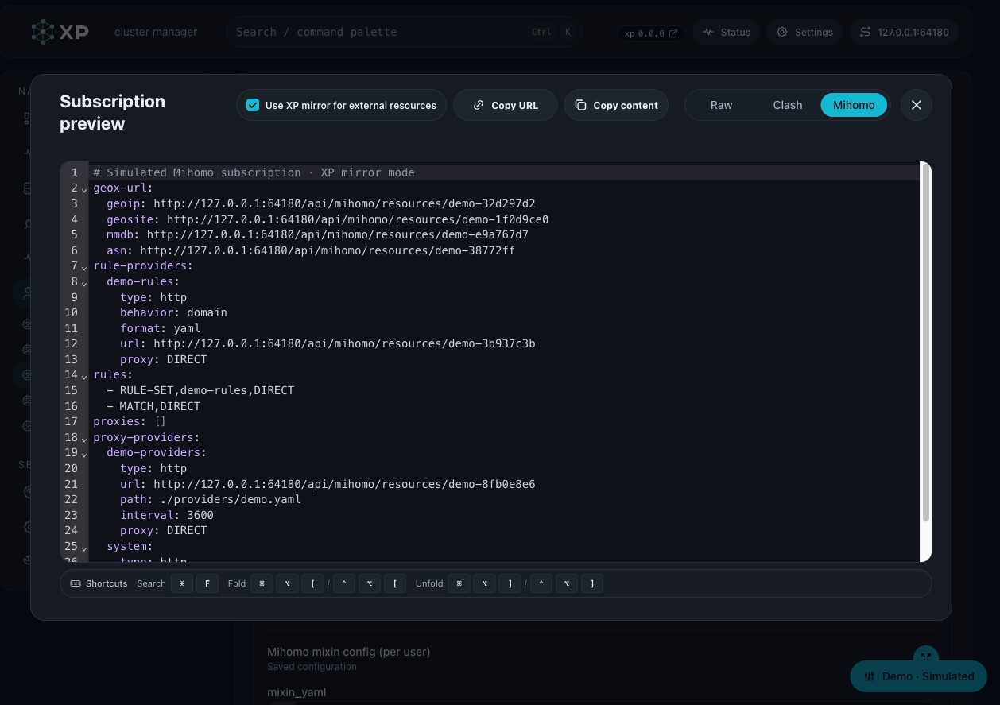
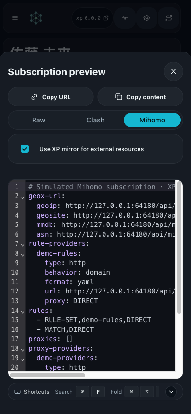

# Mihomo 外部资源镜像

## Context and Scope

Mihomo 客户端可能在代理尚未可用时需要下载 Geo 数据、规则集和代理集。XP 提供按订阅请求选择的资源镜像，使这些下载经过当前服务节点。

- In scope：Mihomo 主配置的外部资源 URL 改写、固定 GeoX 资产、资源目录准入、流式转发和 Web 订阅选项。
- Out of scope：通用 URL 代理、内容缓存、外部 UI 下载、DNS 上游改写、节点地址改写和资源目录管理页面。
- 系统节点与动态代理组语义继续由 [Mihomo provider Spec][provider] 持有。
- 私网目标授权继续由 [节点本地 CIDR Spec][private-policy] 持有。

## Terms and Interfaces

术语以 [GLOSSARY.md][glossary] 中的 External Resource、Resource Mirror 和 Mirror Mode 为准。

| 接口                                          | 用途                    |
| --------------------------------------------- | ----------------------- |
| `GET /api/sub/{token}?format=mihomo`          | canonical Mihomo 主配置 |
| `GET /api/sub/{token}/mihomo/provider`        | 显式 provider 主配置    |
| `GET /api/sub/{token}/mihomo/provider/system` | 系统代理 payload        |
| `GET /api/mihomo/resources/{resource_id}`     | 按资源 ID 代取内容      |

开启镜像的订阅 URL 示例：

```text
https://<node-origin>/api/sub/<token>?format=mihomo&external_resources=mirror
```

## Requirements

### REQ-MIRROR-001 — 显式订阅选项

- 两个 Mihomo 主配置入口必须接受 `external_resources=mirror`；省略参数时保持原始外部资源 URL。
- 参数只能选择镜像模式，不得指定原 URL、镜像 origin 或其他节点；不新增别名或显式 `direct` 值。
- raw/base64/clash 请求携带镜像参数必须返回 `400 invalid_request`；其他参数值必须返回相同错误。
- 系统 provider payload 不承载外部资源改写，客户端不需要向其传递镜像参数。
- 选项只作用于本次输出，不修改持久化 profile 或集群默认值。

### REQ-MIRROR-002 — 改写范围

- 镜像模式必须改写 `geox-url`、`rule-providers` 和外部 `proxy-providers` 的资源 URL。
- 最终配置中来自 mixin 或额外代理 provider 字段的外部资源遵守相同规则。
- `xp-system-generated` 保持系统 provider URL，不得再次包装为外部资源镜像。
- 本地/内联 provider 没有 URL 时无需改写；不得扫描并改写其他 YAML URL。
- 被镜像的 provider 必须使用 `proxy: DIRECT` 下载 XP 资源。

### REQ-MIRROR-003 — GeoX 默认资源

- 镜像模式必须补齐缺失的 `geoip`、`geosite`、`mmdb` 和 `asn`；已有值必须保持原资源选择，仅改写访问地址。
- 默认资源分别使用下表中的 MetaCubeX 资产；不得借镜像选项改动 `geodata-mode` 或自动更新设置。

| GeoX 键   | 固定资产            |
| --------- | ------------------- |
| `geoip`   | `geoip.dat`         |
| `geosite` | `geosite.dat`       |
| `mmdb`    | `geoip.metadb`      |
| `asn`     | `GeoLite2-ASN.mmdb` |

固定原 URL 前缀为 `https://github.com/MetaCubeX/meta-rules-dat/releases/download/latest/`。

### REQ-MIRROR-004 — 配置验证与惰性下载

- 原 URL 必须是无 URL userinfo 的 HTTPS 地址；provider 不得包含自定义 `header` 或 `headers`。
- 查询参数按原 URL 保留；无 userinfo 不代表查询参数一定不含鉴权信息。
- 任一待改写资源违反上述约束时，整个镜像订阅必须返回 `422 invalid_request`，不得跳过或保留原地址兜底。
- 用户没有 Mihomo profile 时，镜像请求必须返回 `422 invalid_request`，不得静默回退为 Clash。
- 订阅生成只验证配置，不主动请求上游；实际下载必须在客户端请求资源端点时发生。
- 省略镜像选项时，现有原地址输出和无 profile 的 Clash 回退语义继续有效。

### REQ-MIRROR-005 — 镜像 origin

- 资源地址必须采用当前订阅请求的公开 origin，路径为 `/api/mihomo/resources/{resource_id}`。
- origin 解析顺序必须保持现有合同：`Forwarded` 优先，然后 `X-Forwarded-*`/`Host`，无法推导时使用节点 `api_base_url` 的 origin。
- 不固定到集群 Primary，不提供镜像节点选择或自动故障转移。

### REQ-MIRROR-006 — 资源地址与生命周期

- `resource_id` 必须由集群 CA key 对规范化原 URL 做 HMAC-SHA-256 得到；请求必须命中当前资源目录。
- 规范化必须去除首尾空白和 fragment、规范化 host；原 URL 查询参数必须保留。
- 资源端点仅凭目录中的完整地址即可访问，不要求订阅 token、管理员认证或短期签名。
- 相同集群密钥与规范化 URL 必须产生稳定共享 ID；资源 URL 可转发，不证明持有人身份。
- 重置订阅 token 不撤销共享资源地址；资源目录不得接纳任意请求 URL。
- 自定义 URL 在最后一个当前 profile 引用移除后必须对新请求返回 `404`；其他 profile 仍引用时继续有效。
- 固定四类 GeoX 资产不依赖 profile 引用；已开始的流式响应不要求随目录移除中止。

### REQ-MIRROR-007 — 转发与资源限制

- XP 必须直接访问原 URL，不使用环境代理、Mesh 或客户端提供的上游 Header。
- 内容必须逐块转发，不缓存、不写磁盘、不聚合完整响应；资源目录元数据不属于内容缓存。
- 所有镜像响应（成功、错误和目录 miss）必须带 `Cache-Control: no-store`；不得透传上游缓存校验或过期元数据。
- 每次请求必须限制为 `256 MiB`、`90` 秒总预算、每进程 `32` 条和单资源 `4` 条并发。
- 服务端最多跟随 `5` 次无 userinfo 的 HTTPS 重定向，不向客户端透传 `Location`。
- 传输中越过大小或时间上限必须终止响应流；已发送响应头后不得承诺改写 HTTP 状态码。

### REQ-MIRROR-008 — 网络目标准入

- 初始 URL 与每次重定向必须重新执行 DNS 与地址校验，连接固定到获准解析结果。
- 私网目标只能通过 [节点本地 CIDR 策略][private-policy] 授权，不使用集群级布尔开关。
- loopback、链路本地和其他策略禁止的特殊地址必须保持拒绝，不能由镜像参数解除限制。

### REQ-MIRROR-009 — 错误与诊断

- 资源请求必须使用下表中的失败语义；上游错误体和敏感原 URL 不得向客户端透传。
- 诊断通过 HTTP 状态与脱敏错误码提供，不新增资源内容、原 URL 或缓存管理页面。

| 情况                             | 结果                         |
| -------------------------------- | ---------------------------- |
| 未知或已失效资源 ID              | `404`                        |
| 策略拒绝目标                     | `403 private_target_blocked` |
| 上游声明内容超过大小上限         | `413`                        |
| 并发限额                         | `429`，`Retry-After: 1`      |
| DNS、连接、TLS 或重定向格式失败  | `502`                        |
| 响应头发出前总预算耗尽           | `504`                        |
| 第六次重定向                     | `508`                        |
| 上游 `4xx/5xx`                   | 保留状态码，替换为脱敏错误体 |
| 响应头发出后传输失败、超限或超时 | 终止响应流                   |

### REQ-MIRROR-010 — Web 订阅入口

- Web 订阅工具栏与预览弹窗必须默认使用原地址；显式勾选镜像后，复制链接与预览请求使用相同模式。
- 镜像选项只在 Mihomo 主配置模式显示；Raw/Clash 不显示，切换格式不得误传镜像参数。
- 选择属于临时订阅输出选项，不持久化为用户 profile 或集群策略。

### REQ-MIRROR-011 — 部署一致性

- 运行中的 systemd、OpenRC 和官方 Docker/Compose 节点必须提供相同镜像合同。
- 镜像由 XP 进程提供，不新增 sidecar、内容缓存目录或驻留下载任务。
- 节点本地 CIDR 默认与覆盖遵守既有部署合同；多节点共享资源 ID 不代表共享网络准入策略。

## Verification

### VER-MIRROR-001

- covers: `REQ-MIRROR-001`
- 主配置两入口启用/省略参数符合模式；非法值及非 Mihomo 格式返回 `400`，profile 保持原样。

### VER-MIRROR-002

- covers: `REQ-MIRROR-002`
- 生成 YAML 的三类资源被改写，provider 为 DIRECT，系统 provider 与其他 URL 保持原语义。

### VER-MIRROR-003

- covers: `REQ-MIRROR-003`
- 无 `geox-url` 时补齐四键，部分输入保持自定义上游优先；Geo 模式和更新设置不变。

### VER-MIRROR-004

- covers: `REQ-MIRROR-004`
- HTTP、userinfo、Header 和无 profile 场景整份拒绝；带合法查询参数可渲染，上游离线不阻断订阅生成。

### VER-MIRROR-005

- covers: `REQ-MIRROR-005`
- 转发头、Host 与节点 origin 回退场景生成正确镜像 origin，参数无法选择其他镜像 origin。

### VER-MIRROR-006

- covers: `REQ-MIRROR-006`
- 资源 ID 稳定且受集群密钥约束；多 profile 共享、最后引用删除、token 重置和固定资源的行为符合生命周期。

### VER-MIRROR-007

- covers: `REQ-MIRROR-007`
- 受控流式上游验证内容、重定向、并发、时间和大小限制，XP 不保存完整内容。

### VER-MIRROR-008

- covers: `REQ-MIRROR-008`
- 源码对初始目标和每次跳转逐跳执行节点 CIDR/DNS 准入并固定获准地址；测试验证禁止 loopback、受控跳转上限和策略过滤基础行为。

### VER-MIRROR-009

- covers: `REQ-MIRROR-009`
- 受控错误上游验证状态映射、错误体脱敏、Retry-After 与响应头发出后的流中止。

### VER-MIRROR-010

- covers: `REQ-MIRROR-010`
- Web 默认不带参数，勾选后复制/预览均带参数，切换 Raw/Clash 后不发送镜像参数。

### VER-MIRROR-011

- covers: `REQ-MIRROR-011`
- 静态检查 systemd、OpenRC 和官方 Docker/Compose 部署入口均运行同一 XP 路由；共享源码读取节点本地策略，且没有额外服务、内容目录或驻留下载任务。

## Visual Evidence

- source_type=ui_demo · target_program=mock-only · capture_scope=page · requested_viewport=1280x900
  - state: `/demo/users/user-fixture-c?demo=normal&d_format=mihomo&d_mirror=mirror&d_preview=preview` with Mihomo mirror enabled and subscription preview open.
  - evidence_note: 工具栏与弹窗共用镜像选择；预览显示 GeoX、规则/代理 provider 镜像地址。
  - 
- source_type=ui_demo · target_program=mock-only · capture_scope=page · requested_viewport=393x852
  - state: `/demo/users/user-fixture-c?demo=normal&d_format=mihomo&d_mirror=mirror&d_preview=preview` with Mihomo mirror enabled and subscription preview open.
  - evidence_note: 移动预览保留开关与格式控件，YAML 在可滚动编辑区内。
  - 

演示预览的关闭与返回行为遵循 [Web Demo Runtime](../web-demo-runtime/SPEC.md) 的历史合同。

## Related ADRs

- [节点本地私网 CIDR 策略](../../adr/0007-node-local-mihomo-private-cidr-policy.md)
- [资源镜像边界](../../adr/0026-mihomo-resource-mirror-boundary.md)

## References

- [实现覆盖](./IMPLEMENTATION.md)
- [主题历史](./HISTORY.md)

[provider]: ../mihomo-provider-dual-track/SPEC.md
[private-policy]: ../mihomo-private-resource-cidrs/SPEC.md
[glossary]: ../../../GLOSSARY.md
