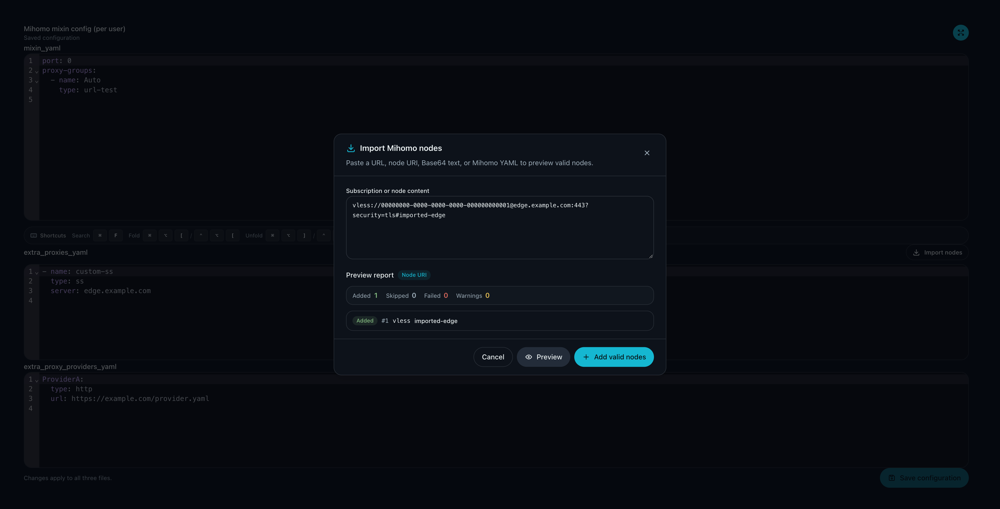
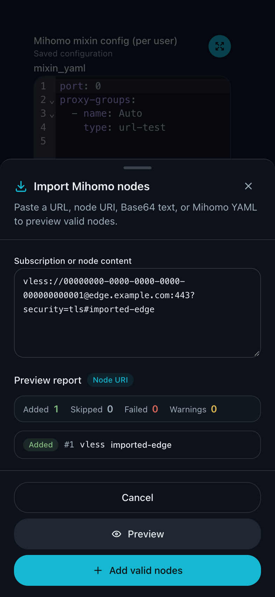

# Mihomo Subscription Node Import

> This file is the durable topic requirements contract. Current implementation facts belong in `IMPLEMENTATION.md`; lifecycle and change references belong in `HISTORY.md`.

## Context and Scope

- Context: The per-user Mihomo Profile already accepts static `extra_proxies_yaml`, but administrators must currently convert copied subscription content by hand before using it.
- In scope: A user-scoped Web import flow that previews external subscription content, converts accepted nodes, and adds them to the current `extra_proxies_yaml` draft.
- Out of scope: Runtime provider refresh, full Mihomo configuration migration, automatic proxy-group changes, node connectivity checks, import history, custom request headers, cookies, and multi-URL batch fetching.

## Terms and Interfaces

- `Import Source`: A copied subscription URL or subscription text submitted for conversion.
- `Imported Node`: A proxy node obtained from an Import Source and added to the current user's Mihomo Profile.
- `Static Node Snapshot`: Imported Nodes stored in `extra_proxies_yaml` rather than refreshed from the original source.
- `Import Draft`: A proposed Profile change that has not been saved through the existing Profile save flow.
- Preview interface: `POST /api/admin/users/{user_id}/subscription-mihomo-import/preview`.
- Persistence interface: Existing `PUT /api/admin/users/{user_id}/subscription-mihomo-profile`.

## Requirements

### REQ-MIHOMO-IMPORT-001 — User-scoped static destination

- The import flow MUST add accepted nodes only to the current user's `extra_proxies_yaml` draft.
- It MUST NOT create or update `extra_proxy_providers_yaml`, cluster state, or a shared node catalog.
- Imported nodes MUST remain Static Node Snapshots after the Profile is saved.

### REQ-MIHOMO-IMPORT-002 — Unified pasted input

- The preview interface MUST accept one pasted `source` value and automatically distinguish a remote subscription URL from subscription text.
- A single trimmed `http://` or `https://` value MAY be fetched as a remote Import Source; all other input is treated as pasted content.
- Multiple remote URLs in one input MUST NOT trigger multiple fetches.

### REQ-MIHOMO-IMPORT-003 — Source format detection

- The importer MUST detect formats in this order: one remote URL, Mihomo/Clash YAML with a `proxies` sequence, Base64 that decodes to supported URI text or such YAML, then raw URI text.
- Blank lines and full-line comments MUST be ignored for raw URI input.
- URI fragments used as node names MUST remain available to name conversion.

### REQ-MIHOMO-IMPORT-004 — Base64 compatibility

- Automatic Base64 detection MUST accept RFC4648 standard and URL-safe alphabets, optional padding, and ASCII whitespace between encoded characters.
- Text MUST be classified as Base64 only when the decoded content is a supported URI list or a supported Mihomo/Clash YAML document.
- Invalid or ambiguous Base64 MUST NOT replace an otherwise valid raw input.

### REQ-MIHOMO-IMPORT-005 — Supported URI schemes

- The first delivery MUST convert common standard URI forms for `vless`, `ss`, `vmess`, `trojan`, `hysteria2`, and `tuic` into Mihomo proxy mappings.
- URI variants that require an unsupported transport or private client extension MUST be reported as failed or warned according to whether the omitted option is required for a usable node.
- Unsupported schemes such as `ssr` or `wireguard` MUST be reported and MUST NOT be copied into the YAML output as raw strings.

### REQ-MIHOMO-IMPORT-006 — Mihomo YAML extraction

- A YAML source MUST be accepted when its root is a mapping containing a `proxies` sequence.
- Each imported YAML proxy MUST be a mapping with a `type`; missing `name` MAY be filled with the deterministic import fallback name.
- Other proxy fields and unknown protocol types MUST be preserved for the existing Profile and Mihomo validation paths.
- Top-level `proxy-groups`, `rules`, `proxy-providers`, ports, and unrelated configuration fields MUST be ignored and reported as ignored input, never merged into the Profile.

### REQ-MIHOMO-IMPORT-007 — Parameter and structure failures

- Missing required connection or authentication fields MUST fail only the affected source item when the remaining input can be processed.
- Non-essential unknown URI parameters MAY produce a warning while retaining the node.
- A non-mapping YAML item, a YAML item without `type`, malformed YAML, or an unsupported required transport MUST produce a clear item-level failure.

### REQ-MIHOMO-IMPORT-008 — Bounded processing

- Pasted source text and each fetched source body MUST be limited to 2 MiB.
- A single import MUST process at most 512 candidate nodes.
- The preview operation MUST enforce a 15-second total fetch deadline and at most 10 redirects for remote sources.
- YAML anchors and aliases MUST be rejected before YAML deserialization so bounded source bytes cannot expand into an unbounded in-memory graph.
- The importer MUST stop with a safe error when a bound is exceeded and MUST NOT partially apply a result outside the preview response.

### REQ-MIHOMO-IMPORT-009 — Public remote fetch policy

- Remote fetching MUST run server-side through the existing public-only Mihomo source policy.
- Only `http` and `https` URLs resolving to public IP addresses MAY be fetched; loopback, private, link-local, documentation, unspecified, multicast, and other special targets MUST be rejected.
- Each redirect target MUST be revalidated against the same policy.
- The request MUST NOT forward custom headers, cookies, Bearer credentials, or proxy settings from the browser.

### REQ-MIHOMO-IMPORT-010 — Import Report

- Every preview response MUST provide an Import Report with per-item status, source index, safe display name when available, protocol when known, warnings, and failure or skip reason.
- The report MUST distinguish added, skipped, warning-bearing, and failed outcomes in summary counts.
- Reasons MUST NOT echo complete credentials, subscription tokens, raw source URLs, or other secret values.

### REQ-MIHOMO-IMPORT-011 — Partial success

- A preview with at least one accepted node MUST return the accepted YAML fragment even when other items fail or are skipped.
- The UI MUST allow adding valid nodes while keeping all failures visible.
- A preview with no accepted nodes MUST produce no YAML fragment and MUST NOT change the current draft.

### REQ-MIHOMO-IMPORT-012 — Naming

- A URI fragment or YAML `name` MUST be preferred as the display name after trimming whitespace.
- Missing names MUST use deterministic names `imported-001`, `imported-002`, and so on in source order.
- A name collision with a different node MUST receive a deterministic numeric suffix such as `name-2` or `name-3`.
- Names reserved by system-generated proxies or relay groups MUST fail rather than be renamed.

### REQ-MIHOMO-IMPORT-013 — Duplicate semantics

- Duplicate detection MUST compare canonical proxy content while ignoring only the display name.
- A node already present in the supplied current draft MUST be skipped even when the incoming display name differs.
- Duplicate candidates within one source MUST be skipped after the first accepted occurrence.
- A skipped duplicate MUST never change the existing node's name or fields.

### REQ-MIHOMO-IMPORT-014 — Draft preservation and ordering

- The preview request MUST use the current `extra_proxies_yaml` draft as the merge and duplicate baseline.
- Existing draft text, comments, node order, and formatting MUST remain unchanged when accepted nodes are added.
- New nodes MUST be appended in source order as a normalized YAML sequence fragment.
- A valid flow-style sequence or YAML document-end marker that cannot accept an appended fragment without rewriting existing text MUST fail preview closed with a safe validation error; the importer MUST NOT rewrite that draft.
- An invalid current draft MUST cause the preview to fail closed without replacing or repairing it.

### REQ-MIHOMO-IMPORT-015 — Explicit apply and save

- The UI MUST provide a dedicated Import nodes action beside `extra_proxies_yaml`.
- Preview, cancellation, and failed requests MUST NOT change the draft.
- Only an explicit Add valid nodes action MAY append the returned fragment to the draft.
- Persisting the draft MUST continue to use the existing Save configuration action and Profile API.

### REQ-MIHOMO-IMPORT-016 — Proxy-group boundary

- Import MUST NOT modify `mixin_yaml`, `proxy-groups`, `rules`, or system-generated group membership.
- Imported nodes MUST be usable only where the resulting Mihomo Profile already references their names or where the administrator manually adds references later.

### REQ-MIHOMO-IMPORT-017 — No active node testing

- Import MUST NOT connect to imported nodes, perform health checks, or update endpoint or node probe state.
- Runtime availability remains the responsibility of Mihomo and the user's existing configuration.

### REQ-MIHOMO-IMPORT-018 — Preview API side effects

- The preview API MUST be admin-authenticated, user-scoped, and side-effect free with respect to Profile persistence and cluster state.
- It MUST return only the accepted new-node YAML fragment and the Import Report needed by the current UI.
- It MUST not persist the original source, imported URL, Base64 text, or Import Report.

### REQ-MIHOMO-IMPORT-019 — Safe failure and concurrency

- The UI MUST apply a preview only when the current draft still matches the draft used to create that preview.
- The preview baseline MUST also remain bound to the target user identity.
- A changed draft MUST invalidate the preview result and require a new preview rather than silently appending to a different draft.
- A Profile changed in another tab MUST continue to be handled by the existing Profile save baseline and conflict protection.

### REQ-MIHOMO-IMPORT-020 — No import history

- The system MUST NOT add an import history table, source snapshot, background refresh job, or persistent audit payload for this feature.
- Logs and metrics MAY record bounded aggregate outcomes, but MUST NOT contain raw source content or node credentials.

## Verification

### VER-MIHOMO-IMPORT-001

- Method: Backend format-detection and conversion tests using raw URI, Base64 variants, and Mihomo YAML fixtures.
- covers: `REQ-MIHOMO-IMPORT-002`, `REQ-MIHOMO-IMPORT-003`, `REQ-MIHOMO-IMPORT-004`, `REQ-MIHOMO-IMPORT-005`, `REQ-MIHOMO-IMPORT-006`, `REQ-MIHOMO-IMPORT-007`.
- Pass condition: Each accepted fixture produces the expected proxy mapping, unsupported or malformed items produce safe report entries, and full configuration fields are not imported.

### VER-MIHOMO-IMPORT-002

- Method: HTTP handler tests with public, private, redirecting, oversized, slow, and multi-URL source fixtures.
- covers: `REQ-MIHOMO-IMPORT-008`, `REQ-MIHOMO-IMPORT-009`, `REQ-MIHOMO-IMPORT-018`.
- Pass condition: Only bounded public fetches succeed; every rejected source leaves no persisted state and returns the documented error category.

### VER-MIHOMO-IMPORT-003

- Method: Backend merge tests with existing nodes, duplicate content, name collisions, reserved names, invalid drafts, partial failures, and 512-node limits.
- covers: `REQ-MIHOMO-IMPORT-010`, `REQ-MIHOMO-IMPORT-011`, `REQ-MIHOMO-IMPORT-012`, `REQ-MIHOMO-IMPORT-013`, `REQ-MIHOMO-IMPORT-014`.
- Pass condition: The response contains stable counts and a deterministic new-node fragment; existing content remains unchanged and reserved or invalid items fail closed.

### VER-MIHOMO-IMPORT-004

- Method: React component and interaction tests for opening the dialog, previewing, showing report states, canceling, adding valid nodes, stale-draft rejection, and saving through the existing Profile flow.
- covers: `REQ-MIHOMO-IMPORT-015`, `REQ-MIHOMO-IMPORT-019`.
- Pass condition: Only explicit Add valid nodes changes the draft, stale previews cannot be applied, and existing save protection remains in control of persistence.

### VER-MIHOMO-IMPORT-005

- Method: Profile rendering and Mihomo contract tests with imported nodes and unchanged custom groups.
- covers: `REQ-MIHOMO-IMPORT-001`, `REQ-MIHOMO-IMPORT-016`, `REQ-MIHOMO-IMPORT-017`.
- Pass condition: Imported nodes appear only in the user's top-level extra proxies, no group or probe state is changed, and the final Profile continues through existing validation.

### VER-MIHOMO-IMPORT-006

- Method: Security review of request logs, response caching, error rendering, and persistence paths.
- covers: `REQ-MIHOMO-IMPORT-010`, `REQ-MIHOMO-IMPORT-018`, `REQ-MIHOMO-IMPORT-020`.
- Pass condition: Raw sources, URLs, tokens, and credentials are absent from durable logs, caches, history, and error messages.

## Related ADRs

- [ADR 0028: Store Imported Subscription Nodes as Static Profile Snapshots](../../adr/0028-mihomo-static-subscription-import.md)

## Visual Evidence

- source_type: storybook_canvas; story_id_or_title: Components/MihomoProfileEditor/ImportPreviewReport; requested_viewport: none; viewport_strategy: storybook-viewport; margin_policy: require_margin; evidence_surface: component; state: preview report; evidence_note: Desktop preview shows pasted content, source detection, compact counts, item report, and Add valid nodes action; sensitive_exclusion: N/A; submission_gate: approved.
  
- source_type: storybook_canvas; story_id_or_title: Components/MihomoProfileEditor/ImportPreviewReportMobile; requested_viewport: 393x852; viewport_strategy: storybook-viewport; margin_policy: require_margin; evidence_surface: component; state: responsive preview report; evidence_note: Mobile bottom drawer keeps the report readable, compacts counts into one row, and keeps all actions reachable without overflow; sensitive_exclusion: N/A; submission_gate: approved.
  

## References

- [Mihomo subscription output](../../desgin/subscription.md)
- [Mihomo provider contract](../mihomo-provider-dual-track/SPEC.md)
- [Mihomo Profile workspace](../mihomo-subscription-template/SPEC.md)
- [Web Mihomo tools](../web-tools-mihomo-redact/SPEC.md)
- [Project glossary](../../GLOSSARY.md)
- `./IMPLEMENTATION.md`
- `./HISTORY.md`
