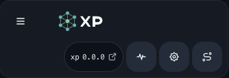
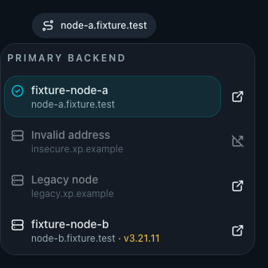

# Embedded PWA cross-origin primary backend

## Related ADRs

- [ADR 0011](../../adr/0011-cross-origin-primary-backend-for-embedded-pwa.md)
- [ADR 0012](../../adr/0012-edgeone-static-web-console.md)
- [ADR 0013](../../adr/0013-authenticated-node-directory-for-static-console.md)

## Context and Scope

The embedded XP Web/PWA is served by the node where it was installed. If that
node becomes unreachable, the cached interface remains open but its relative
API and status-stream requests cannot reach the cluster. This specification
defines a manual primary-backend selector that keeps the static app shell and
Service Worker on the installation origin while sending browser API traffic to
one verified same-cluster node origin.

The scope includes the Rust `/api` browser-CORS middleware, the Web transport
and profile store, candidate verification, the AppShell header selector, query
and SSE refresh behavior, the mutation switch barrier, controlled UI tests,
and operator-facing deployment documentation.

The scope excludes cross-origin cookies, automatic failover, arbitrary URL entry,
background polling, request replay, multi-cluster profiles, changes to server-side
node forwarding/Raft coordination, and changes to PWA app-shell caching or
installation scope. Independent static Web deployment is defined separately by
ADR 0012 and does not alter this embedded-PWA contract.

## Requirements

- **REQ-CORS**: Each node MUST derive its browser CORS allowlist at request
  time from the current registered `Node.api_base_url` set. It MUST allow only
  the exact canonical HTTPS origin of a registered node, except for exact Static
  Web Console origins admitted by the separate Static Console-Compatible Node
  contract in ADR 0012. It MUST reject unknown, non-HTTPS, path-bearing,
  query-bearing, or removed-node origins. The Static Console exception MUST NOT
  be inferred from Node metadata or permit a wildcard origin.
- **REQ-CORS-PREFLIGHT**: `/api` preflight responses MUST support the actual
  `GET`, `POST`, `PUT`, `PATCH`, and `DELETE` methods and the
  `Authorization`, `Content-Type`, and `Accept` request headers. They MUST
  return `Vary` for `Origin`, `Access-Control-Request-Method`, and
  `Access-Control-Request-Headers`. Static resources MUST NOT receive this
  browser CORS surface.
- **REQ-DOCUMENT-CSP**: Embedded `index.html` and SPA fallback HTML MUST set
  `connect-src` to `'self'` plus the current registered Nodes' exact canonical
  HTTPS origins. The directive MUST be generated from the same origin policy as
  browser CORS, excluding invalid or removed-node metadata. Assets and
  `sw.js` MUST retain their existing response headers and MUST NOT receive this
  dynamic document policy.
- **REQ-CANDIDATE**: A candidate MUST come only from the current page origin
  or an authenticated current-cluster node inventory. Before a credentialed
  probe, the browser MUST verify public health, matching `cluster_id`, an
  immutable compatible API release profile, and the candidate inventory. A
  failed check MUST neither persist nor select the candidate.
- **REQ-NODE-DIRECTORY**: After authentication, the selector MUST derive its
  rows from the current cluster's registered node inventory. Each row MUST
  show the registered node name and HTTPS origin, mark the selected node, and
  retain an independent frontend-opening action. Static Web Console mode MAY
  read this inventory only after its authenticated Runtime Policy has admitted
  the selected backend; anonymous pages MUST NOT discover or enumerate nodes.
- **REQ-NODE-LINK**: The per-node frontend action MUST open a new tab with
  `noopener noreferrer`, preserve the current pathname, query and hash, and
  use the existing login handoff without sending credentials through an API
  proxy. The action MUST remain available for the current or non-switchable
  node when its HTTPS origin is valid. An invalid origin MUST disable only the
  frontend action and explain the reason. Switching and opening a node MUST be
  separate keyboard-accessible controls without nested interactive elements.
- **REQ-SERVICE-VERSION**: Opening the selector MUST trigger one authenticated,
  bounded refresh of registered-node service versions. The server MUST resolve
  each target by registered node ID and HTTPS address, use only the fixed
  `/api/cluster/info` route, require the same cluster ID, reject redirects,
  cap the response body and time budget, and
  degrade an old or unavailable node to an unknown version. The Web client MUST
  compare only a recognized formal frontend release version (not a package
  version, backend version, or build hash), normalize the optional `v` prefix,
  and display the service version only when it differs. If the frontend release
  version is unrecognized, the selector MUST omit the service-version
  comparison entirely. Unknown or timed-out node reads MUST NOT block
  inventory, switching, or node opening.
- **REQ-TRANSPORT**: The browser MUST use one selected primary origin for all
  relative `/api/*` requests and SSE requests through centralized transport
  rewriting. Static resources, navigation, Service Worker traffic, and the
  existing full-page `Open on node` handoff MUST remain on the page origin.
- **REQ-EXTERNAL-URL**: Any absolute URL emitted for an external consumer,
  including a copied subscription URL, MUST use the current verified Primary
  Backend origin. It MUST be directly consumable without the Web app's
  JavaScript, Service Worker, local storage, or fetch rewrite. The URL's format
  and temporary Mihomo mirror query MUST match the content selected in the UI.
- **REQ-PROFILE**: Verified backend profiles MUST be persisted by `cluster_id`
  and contain the selected origin and verified candidates. A different cluster
  MUST NOT reuse another cluster's credentials, candidates, or cached profile.
  Offline or unreachable states MUST preserve the last profile and cached UI.
- **REQ-BARRIER**: An in-flight `POST`, `PUT`, `PATCH`, or `DELETE` MUST block
  a primary switch until it reaches a terminal result or a 60-second unknown
  timeout. A timeout MUST never replay the mutation; after the timeout an
  administrator MAY switch manually and MUST be shown the unknown-result
  state.
- **REQ-NAV**: The AppShell MUST expose the primary-backend selector as the
  rightmost header control, after Settings, on desktop and narrow viewports.
  It MUST provide accessible labels and keep the selector and adjacent
  controls within the viewport.

## Verification

- **VER-CORS-ROUTES** covers: REQ-CORS and REQ-CORS-PREFLIGHT. `cargo test http::browser_cors` and
  `cargo test http::tests::browser_cors_routes::reads_registered_origins_for_api_only`
  verify registered-origin preflight/actual requests, unknown origins, static
  resource isolation, and immediate rejection after node removal.
- **VER-DOCUMENT-CSP** covers: REQ-DOCUMENT-CSP. `cargo test http::embedded_ui`
  and `cargo test http::tests::ui_serves_index_at_root_and_embedded_assets`
  verify exact origin normalization, invalid-origin exclusion, and the absence
  of the dynamic header on assets and `sw.js`. The controlled
  `primary-backend-switcher` browser test verifies that a listed origin is
  reachable when CSP and CORS agree and that an unlisted origin is blocked by
  the document policy.
- **VER-CANDIDATE** covers: REQ-CANDIDATE. The command
  `cd web && bun run test -- src/backend/primaryBackend.test.ts` verifies
  health/cluster/compatibility ordering, the credential gate, inventory
  membership, and stale-node removal.
- **VER-NODE-DIRECTORY** covers: REQ-NODE-DIRECTORY. The authenticated node
  inventory and selector Storybook state verify real names, current-node
  marking, the static-policy gate, and the absence of the old generic
  `Verified backend` placeholder.
- **VER-NODE-LINK** covers: REQ-NODE-LINK. The Storybook browser test verifies
  independent switch/link controls, new-tab attributes, path/query/hash and
  login-token handoff, while navigation unit tests retain invalid-origin
  disablement.
- **VER-SERVICE-VERSION** covers: REQ-SERVICE-VERSION. Rust HTTP tests and
  the Web API/backend tests verify the fixed authenticated route, cluster
  binding, bounded fan-out, redirect rejection, old-backend degradation,
  release-version normalization, mismatch-only display, and unknown/timeout
  states.
- **VER-TRANSPORT** covers: REQ-TRANSPORT. The transport tests and
  `cd web && bun run test:e2e -- primary-backend-switcher --workers=1` verify
  API and SSE rewriting to a controlled recovery origin while assets stay on
  the page origin.
- **VER-EXTERNAL-URL** covers: REQ-EXTERNAL-URL. Subscription URL unit and
  UserDetails tests verify that copied URLs use the active backend origin and
  preserve format and mirror parameters instead of using the static page origin.
- **VER-PROFILE** covers: REQ-PROFILE. The transport/profile tests verify
  cluster-keyed persistence, cached candidates during reachability failure,
  and no cross-cluster credential reuse.
- **VER-BARRIER** covers: REQ-BARRIER. The mutation-barrier test advances the
  60-second timeout, checks the unknown-result counter, and proves no replay
  request is generated.
- **VER-UI** covers: REQ-NAV. The Storybook suite
  `primary-backend-switcher.spec.ts` verifies right-edge control ordering,
  narrow-menu bounds, keyboard-accessible labels, and non-overlapping
  AppShell controls. The approved controlled captures below are the visual
  evidence set.

## Visual Evidence

- source_type: storybook_canvas
  target_program: mock-only
  capture_scope: element
  requested_viewport: 1280x900
  viewport_strategy: storybook-viewport
  margin_policy: require_margin
  evidence_surface: component
  surface_selector: '[data-visual-evidence-surface]'
  target_selector: '[data-visual-evidence-target]'
  sensitive_exclusion: N/A
  submission_gate: approved
  story_id_or_title: Components/AppShell/Default
  state: AppShell header with the XP lockup, primary backend is the rightmost control, desktop
  evidence_note: verifies single-row layout and Status -> Settings -> Primary backend order.
  image:
  

- source_type: storybook_canvas
  target_program: mock-only
  capture_scope: element
  requested_viewport: 393x852
  viewport_strategy: storybook-viewport
  margin_policy: require_margin
  evidence_surface: component
  surface_selector: '[data-visual-evidence-surface]'
  target_selector: '[data-visual-evidence-target]'
  sensitive_exclusion: N/A
  submission_gate: approved
  story_id_or_title: Components/AppShell/Default
  state: AppShell header with XP lockup and rightmost primary backend, 393x852 mobile
  evidence_note: verifies two-row layout, touch-sized controls, and right-edge ordering.
  image:
  

- source_type: storybook_canvas
  target_program: mock-only
  capture_scope: browser-viewport
  requested_viewport: 1280x720
  viewport_strategy: storybook-viewport
  margin_policy: trim_only
  evidence_surface: page
  surface_selector: N/A (canvas overlay state)
  target_selector: N/A (canvas overlay state)
  sensitive_exclusion: N/A
  submission_gate: approved
  story_id_or_title: Components/PrimaryBackendSwitcher/VersionMismatchAndLinks
  state: authenticated node directory with current, unavailable, invalid-address, and
  mismatched-version entries
  evidence_note: verifies real node names and hosts, separate new-tab actions, invalid HTTPS
  handling, hidden unknown versions, and a visible v3.21.11 mismatch label.
  image:
  
