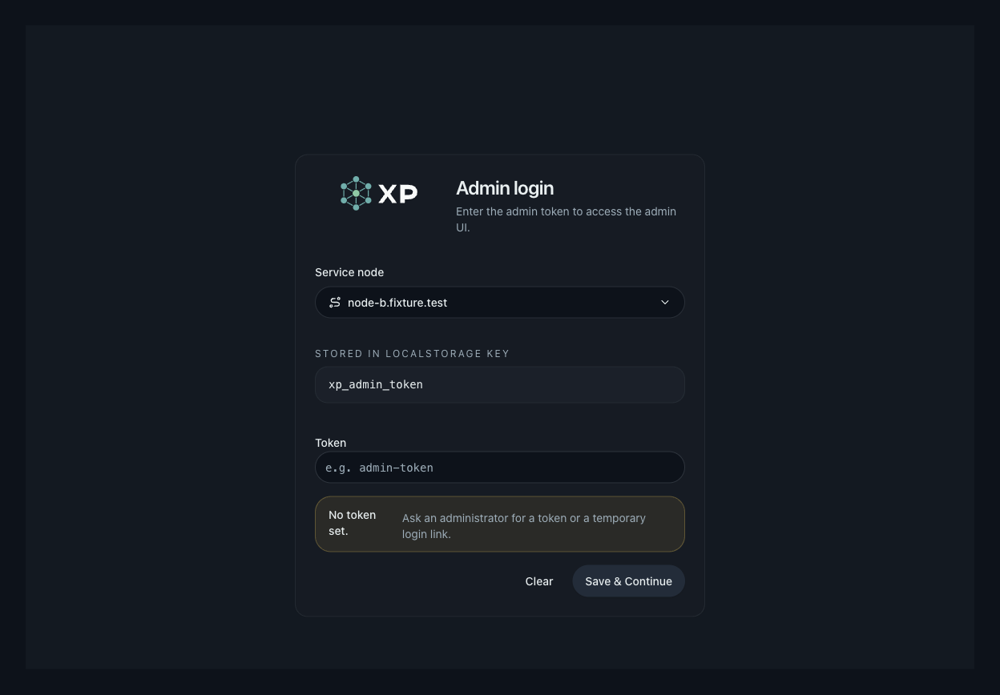
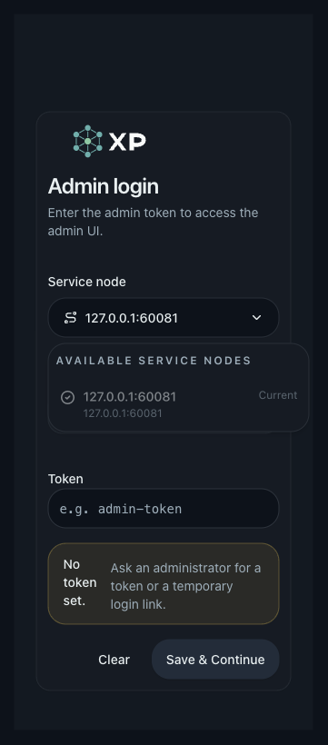

# Embedded PWA cross-origin primary backend

## Related ADRs

- [ADR 0011](../../adr/0011-cross-origin-primary-backend-for-embedded-pwa.md)
- [ADR 0012](../../adr/0012-edgeone-static-web-console.md)
- [ADR 0028](../../adr/0028-pre-auth-primary-backend-recovery.md)

## Context and Scope

The embedded XP Web/PWA is served by the node where it was installed. If that
node becomes unreachable, the cached interface remains open but its relative
API and status-stream requests cannot reach the cluster. This specification
defines a manual primary-backend selector that keeps the static app shell and
Service Worker on the installation origin while sending browser API traffic to
one verified same-cluster node origin.

The scope includes the Rust `/api` browser-CORS middleware, the Web transport
and profile store, candidate verification, the AppShell header selector, query
and SSE refresh behavior, the mutation switch barrier, controlled UI tests,
and operator-facing deployment documentation.

The existing implementation has a login recovery gap: the selector is only
available inside the authenticated AppShell, while login verification is sent
to the current transport target. A stale or node-local token can therefore
leave an administrator on the login page with no way to choose a previously
verified same-cluster backend. This extension defines the pre-auth recovery
path and cold-start restoration of a persisted primary origin.

The scope excludes cross-origin cookies, automatic failover, arbitrary URL entry,
background polling, request replay, multi-cluster profiles, changes to server-side
node forwarding/Raft coordination, and changes to PWA app-shell caching or
installation scope. Independent static Web deployment is defined separately by
ADR 0012 and does not alter this embedded-PWA contract.

## Requirements

- **REQ-CORS**: Each node MUST derive its browser CORS allowlist at request
  time from the current registered `Node.api_base_url` set. It MUST allow only
  the exact canonical HTTPS origin of a registered node, except for exact Static
  Web Console origins admitted by the separate Static Console-Compatible Node
  contract in ADR 0012. It MUST reject unknown, non-HTTPS, path-bearing,
  query-bearing, or removed-node origins. The Static Console exception MUST NOT
  be inferred from Node metadata or permit a wildcard origin.
- **REQ-CORS-PREFLIGHT**: `/api` preflight responses MUST support the actual
  `GET`, `POST`, `PUT`, `PATCH`, and `DELETE` methods and the
  `Authorization`, `Content-Type`, and `Accept` request headers. They MUST
  return `Vary` for `Origin`, `Access-Control-Request-Method`, and
  `Access-Control-Request-Headers`. Static resources MUST NOT receive this
  browser CORS surface.
- **REQ-DOCUMENT-CSP**: Embedded `index.html` and SPA fallback HTML MUST set
  `connect-src` to `'self'` plus the current registered Nodes' exact canonical
  HTTPS origins. The directive MUST be generated from the same origin policy as
  browser CORS, excluding invalid or removed-node metadata. Assets and
  `sw.js` MUST retain their existing response headers and MUST NOT receive this
  dynamic document policy.
- **REQ-CANDIDATE**: A candidate MUST come only from the current page origin
  or an authenticated current-cluster node inventory. Before a credentialed
  probe, the browser MUST verify public health, matching `cluster_id`, an
  immutable compatible API release profile, and the candidate inventory. A
  failed check MUST neither persist nor select the candidate.
- **REQ-TRANSPORT**: The browser MUST use one selected primary origin for all
  relative `/api/*` requests and SSE requests through centralized transport
  rewriting. Static resources, navigation, Service Worker traffic, and the
  existing full-page `Open on node` handoff MUST remain on the page origin.
- **REQ-PROFILE**: Verified backend profiles MUST be persisted by `cluster_id`
  and contain the selected origin and verified candidates. A different cluster
  MUST NOT reuse another cluster's credentials, candidates, or cached profile.
  Offline or unreachable states MUST preserve the last profile and cached UI.
- **REQ-BARRIER**: An in-flight `POST`, `PUT`, `PATCH`, or `DELETE` MUST block
  a primary switch until it reaches a terminal result or a 60-second unknown
  timeout. A timeout MUST never replay the mutation; after the timeout an
  administrator MAY switch manually and MUST be shown the unknown-result
  state.
- **REQ-NAV**: The AppShell MUST expose the primary-backend selector as the
  rightmost header control, after Settings, on desktop and narrow viewports.
  It MUST provide accessible labels and keep the selector and adjacent
  controls within the viewport.
- **REQ-PREAUTH-SELECTOR**: The Login page MUST expose a service-node selector
  when the browser has the current page origin or one or more persisted
  candidates for the active cluster profile. The selector MUST be keyboard
  accessible and MUST identify each candidate by node name when available and
  origin host as a fallback.
- **REQ-PREAUTH-SOURCE**: Pre-auth candidates MUST be limited to the current
  page origin and candidates already recorded in the browser's cluster-keyed
  backend profile. The Web client MUST NOT add arbitrary operator-entered
  origins, perform anonymous node-inventory discovery, or show candidates from
  another stored cluster profile.
- **REQ-PREAUTH-PROBE**: Before a pre-auth candidate becomes selectable, the
  browser MUST perform the existing public checks for health, matching
  `cluster_id`, and compatible API release profile. These checks MUST NOT send
  the admin token. A failed or stale candidate MUST remain unselected and
  MUST expose a retryable error without deleting the last known profile.
- **REQ-PREAUTH-TARGET**: While the Login page is active, the selected
  candidate MUST be the target for token verification and subsequent relative
  `/api/*` requests in that tab. The login attempt MUST NOT mix the current
  page origin and the selected candidate for authentication.
- **REQ-PREAUTH-401**: A `401` or other structured authentication rejection
  from the selected candidate MUST keep the Login page open, preserve the
  selected candidate, avoid persisting the unverified token, and allow the
  administrator to change candidate or edit the token.
- **REQ-PREAUTH-RESTORE**: On a non-static-console cold start, the transport
  MUST restore the persisted primary origin for the active cluster profile
  before the first authenticated API request, provided the origin is a
  canonical HTTPS origin recorded in that profile. If it cannot be reached,
  the Login page MUST still offer the current page origin as an explicit
  recovery choice.
- **REQ-PREAUTH-PERSIST**: A pre-auth choice MUST remain session-local until
  token verification succeeds. The selected origin MAY become the durable
  primary backend only after successful authentication and normal cluster
  profile hydration.
- **REQ-TOKEN-CONSISTENCY**: Nodes in one cluster MUST continue to use the
  cluster admin-token contract. A token accepted by one healthy member but
  rejected by another same-cluster member is an operator/deployment
  consistency failure; the Web client MUST NOT work around it by introducing
  per-node credentials or automatic retry on another node.

## Verification

- **VER-CORS-ROUTES** covers: REQ-CORS and REQ-CORS-PREFLIGHT. `cargo test http::browser_cors` and
  `cargo test http::tests::browser_cors_routes::reads_registered_origins_for_api_only`
  verify registered-origin preflight/actual requests, unknown origins, static
  resource isolation, and immediate rejection after node removal.
- **VER-DOCUMENT-CSP** covers: REQ-DOCUMENT-CSP. `cargo test http::embedded_ui`
  and `cargo test http::tests::ui_serves_index_at_root_and_embedded_assets`
  verify exact origin normalization, invalid-origin exclusion, and the absence
  of the dynamic header on assets and `sw.js`. The controlled
  `primary-backend-switcher` browser test verifies that a listed origin is
  reachable when CSP and CORS agree and that an unlisted origin is blocked by
  the document policy.
- **VER-CANDIDATE** covers: REQ-CANDIDATE. The command
  `cd web && bun run test -- src/backend/primaryBackend.test.ts` verifies
  health/cluster/compatibility ordering, the credential gate, inventory
  membership, and stale-node removal.
- **VER-TRANSPORT** covers: REQ-TRANSPORT. The transport tests and
  `cd web && bun run test:e2e -- primary-backend-switcher --workers=1` verify
  API and SSE rewriting to a controlled recovery origin while assets stay on
  the page origin.
- **VER-PROFILE** covers: REQ-PROFILE. The transport/profile tests verify
  cluster-keyed persistence, cached candidates during reachability failure,
  and no cross-cluster credential reuse.
- **VER-BARRIER** covers: REQ-BARRIER. The mutation-barrier test advances the
  60-second timeout, checks the unknown-result counter, and proves no replay
  request is generated.
- **VER-UI** covers: REQ-NAV. The Storybook suite
  `primary-backend-switcher.spec.ts` verifies right-edge control ordering,
  narrow-menu bounds, keyboard-accessible labels, and non-overlapping
  AppShell controls. The approved controlled captures below are the visual
  evidence set.
- **VER-PREAUTH-SELECTOR** covers: REQ-PREAUTH-SELECTOR, REQ-PREAUTH-SOURCE.
  Login-page and Storybook tests MUST cover keyboard
  access, node-name/host labels, current-origin fallback, active-profile
  filtering, and zero-candidate recovery.
- **VER-PREAUTH-PROBE** covers: REQ-PREAUTH-PROBE. Transport and browser tests
  MUST cover public health, cluster, and compatibility checks without an
  Authorization header, plus retryable failures that do not delete cached
  candidates.
- **VER-PREAUTH-TARGET** covers: REQ-PREAUTH-TARGET. Login-page and browser
  tests MUST prove that token verification and later relative API/SSE requests
  use the selected origin for the active tab.
- **VER-PREAUTH-401** covers: REQ-PREAUTH-401. Login-page tests MUST prove that
  a structured authentication rejection keeps the page open, preserves the
  selection, and does not persist the unverified token.
- **VER-PREAUTH-RESTORE** covers: REQ-PREAUTH-RESTORE. Transport tests MUST
  cover cold-start restoration of a canonical active-profile primary and the
  current-page recovery fallback.
- **VER-PREAUTH-PERSIST** covers: REQ-PREAUTH-PERSIST. Transport and browser
  tests MUST prove that a pre-auth choice is session-local until authenticated
  node-inventory hydration succeeds, after which the selected origin may be
  persisted.
- **VER-TOKEN-CONSISTENCY** covers: REQ-TOKEN-CONSISTENCY. Backend or
  integration coverage MUST prove that a joined node receives the cluster
  admin-token hash and that the Web recovery flow does not add per-node token
  state.

## Visual Evidence

- source_type: storybook_canvas
  target_program: mock-only
  capture_scope: element
  requested_viewport: 1280x900
  viewport_strategy: storybook-viewport
  margin_policy: require_margin
  evidence_surface: component
  surface_selector: '[data-visual-evidence-surface]'
  target_selector: '[data-visual-evidence-target]'
  sensitive_exclusion: N/A
  submission_gate: approved
  story_id_or_title: Components/AppShell/Default
  state: AppShell header with the XP lockup, primary backend is the rightmost control, desktop
  evidence_note: verifies single-row layout and Status -> Settings -> Primary backend order.
  image:
  

- source_type: storybook_canvas
  target_program: mock-only
  capture_scope: element
  requested_viewport: 393x852
  viewport_strategy: storybook-viewport
  margin_policy: require_margin
  evidence_surface: component
  surface_selector: '[data-visual-evidence-surface]'
  target_selector: '[data-visual-evidence-target]'
  sensitive_exclusion: N/A
  submission_gate: approved
  story_id_or_title: Components/AppShell/Default
  state: AppShell header with XP lockup and rightmost primary backend, 393x852 mobile
  evidence_note: verifies two-row layout, touch-sized controls, and right-edge ordering.
  image:
  

- source_type: storybook_canvas
  target_program: mock-only
  capture_scope: element
  requested_viewport: 1280x900
  viewport_strategy: storybook-viewport
  margin_policy: require_margin
  evidence_surface: component
  surface_selector: '[data-visual-evidence-surface]'
  target_selector: '[data-visual-evidence-target]'
  sensitive_exclusion: N/A
  submission_gate: approved
  story_id_or_title: Views/LoginPage/PreAuthBackendRecovery
  state: Login page with a known same-cluster backend candidate selected
  evidence_note: verifies that a stale current-node token does not hide the
  service-node recovery control and that the selected target is visible at
  1280x900 without overflow or overlap.
  image:
  

- source_type: storybook_canvas
  target_program: mock-only
  capture_scope: element
  requested_viewport: 393x852
  viewport_strategy: storybook-viewport
  margin_policy: require_margin
  evidence_surface: component
  surface_selector: '[data-visual-evidence-surface]'
  target_selector: '[data-visual-evidence-target]'
  sensitive_exclusion: N/A
  submission_gate: approved
  story_id_or_title: Views/LoginPage/ZeroCandidates
  state: Login page with current-page fallback and the service-node menu open
  evidence_note: verifies the mobile selector, zero-candidate recovery state,
  token form, error surface, and actions fit within the viewport.
  image:
  
